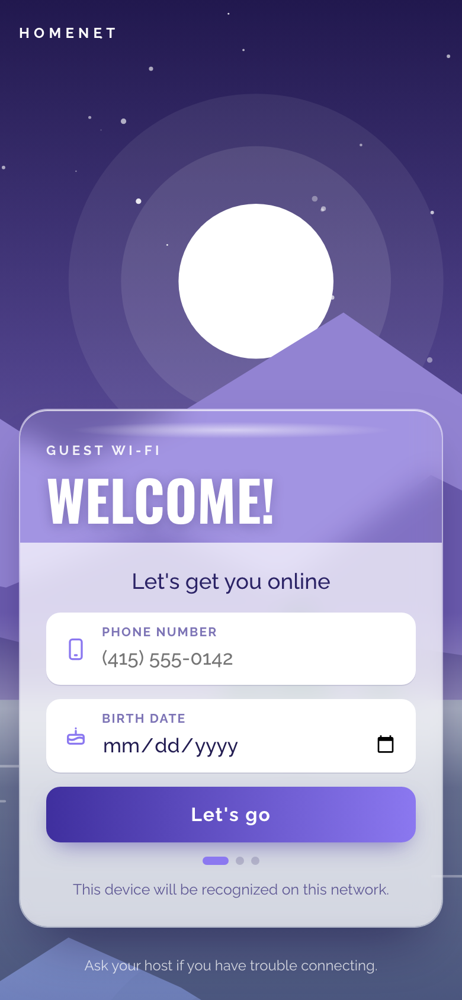
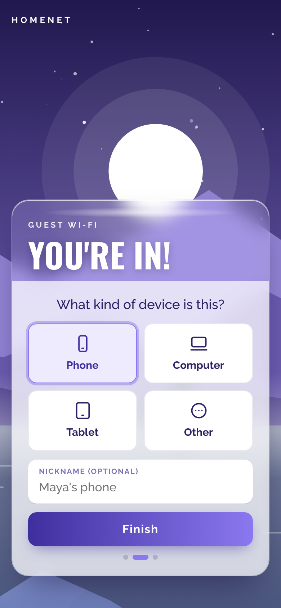
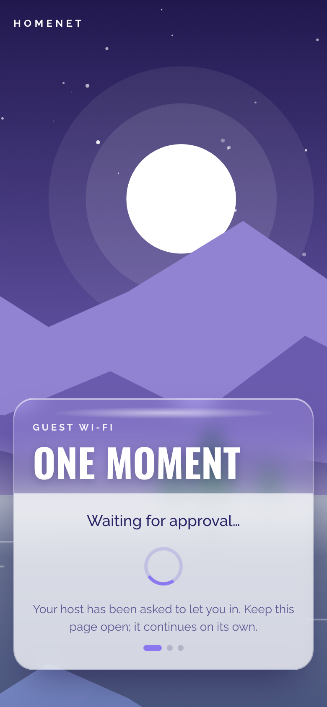
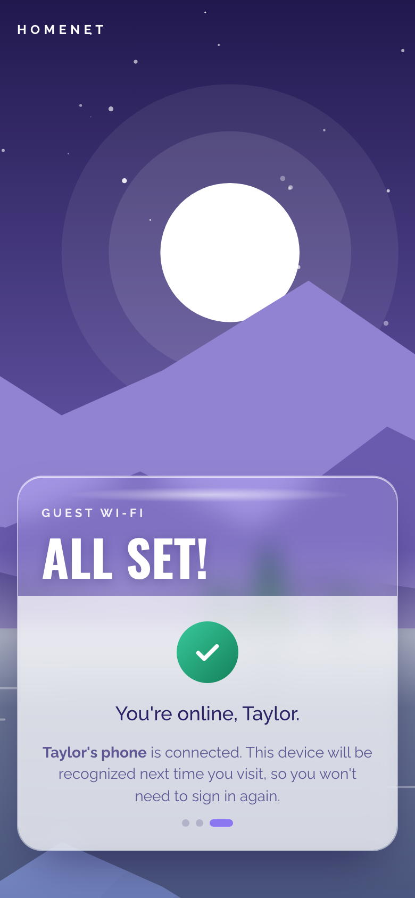
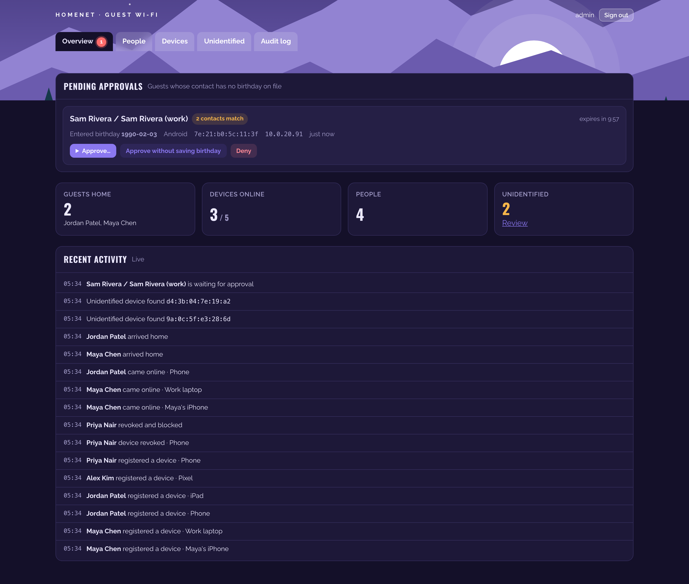
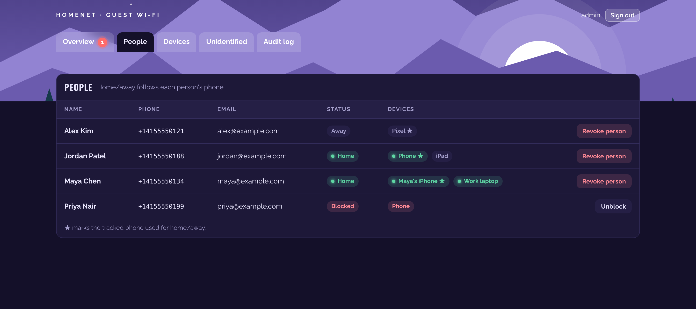
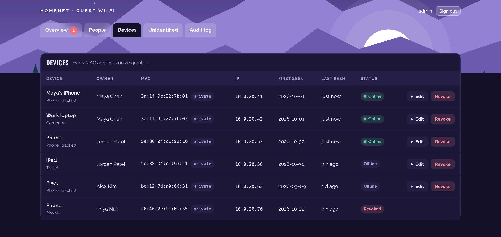
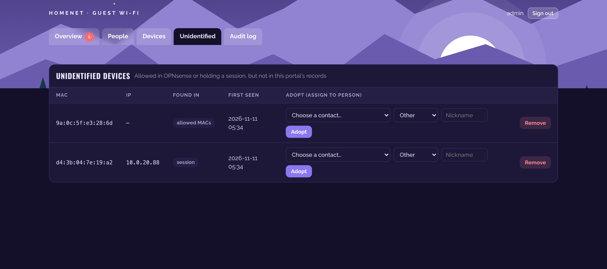
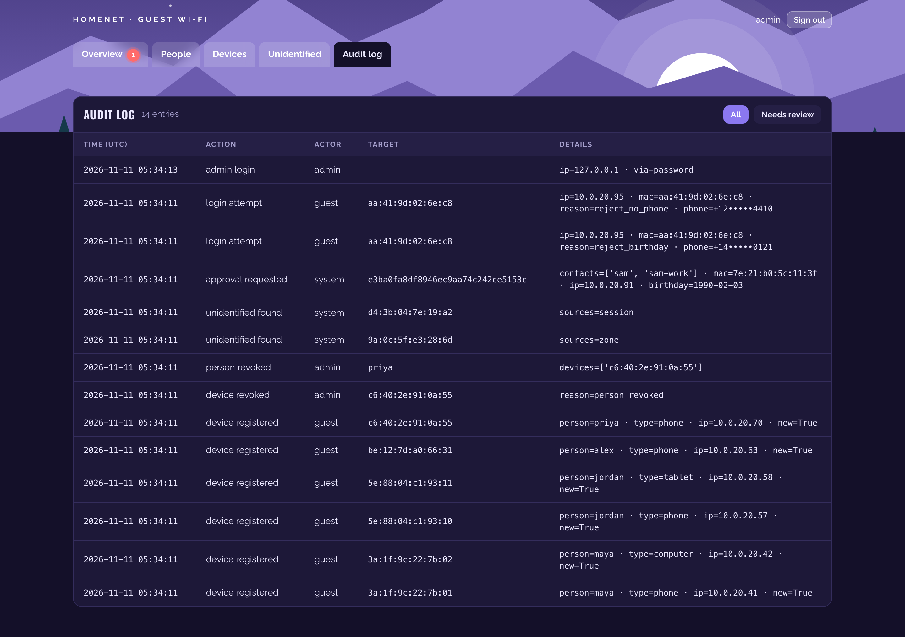
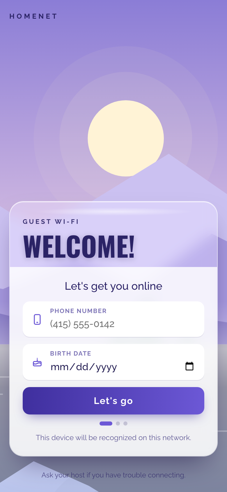

# Guest Wi‑Fi Portal

A self-hosted login page for the guest Wi‑Fi. Guests sign in with their phone number and birth date, which are checked against your Nextcloud contacts. The portal then lets their device in through the OPNsense API and tracks who is home. Home Assistant gets live updates and actionable approval notifications.

<p align="center">
  
  
  
  
</p>

<p align="center">
  
</p>

<details>
<summary><b>More screenshots</b>: admin pages, the one-phone prompt, light mode</summary>

**People:** home/away from each person's tracked phone (★), with revoke and unblock.



**Devices:** every granted MAC with owner, IP, first/last seen and online status. `private` marks a randomized MAC.



**Unidentified:** MACs allowed in OPNsense or holding a session that the portal doesn't know, with Adopt and Remove.



**Audit log:** sign-ins, failures (phone numbers masked), approvals, revocations and CardDAV writes.



**Admin sign-in** and the guest page in **light mode** (it follows the device setting):

<p>
  
  
</p>

</details>

All names, numbers and addresses in the screenshots are made-up demo data.

```
app/             FastAPI app: guest pages, admin UI, REST + SSE API, background workers
tests/           98 tests with mocked OPNsense and CardDAV
deploy/          auto-update timer for the server
docs/            screenshots
scripts/         demo server and screenshot generator
.github/         CI: tests on every PR, image published to GHCR on every push to main; branch-protection ruleset
docker-compose.yml
.env.example
```

The Home Assistant integration lives in its own repo, [ha-guest-wifi-portal](https://github.com/shreyasajj/ha-guest-wifi-portal), because HACS needs `custom_components/` at a repo root.

## Contents

1. [How it works](#how-it-works)
2. [Network design](#network-design)
3. [OPNsense setup](#opnsense-setup)
4. [UniFi SSID setup](#unifi-ssid-setup)
5. [Nextcloud app password](#nextcloud-app-password)
6. [Reverse proxy and client identification](#reverse-proxy-and-client-identification)
7. [Run the portal](#run-the-portal)
   - [GitHub, CI and automatic deploys](#github-ci-and-automatic-deploys)
8. [Admin sign-in with Authelia](#admin-sign-in-with-authelia)
9. [Home Assistant](#home-assistant)
10. [MAC randomization: what to tell guests](#mac-randomization-what-to-tell-guests)
11. [OPNsense API endpoints used](#opnsense-api-endpoints-used)
12. [Portal API](#portal-api)
13. [Security notes](#security-notes)
14. [Development and tests](#development-and-tests)

---

## How it works

1. A guest joins the **HomeNet Guest** SSID (WPA2/WPA3 password). They get **internet only**.
2. They open `https://wifi.home.example`. Phones can offer this page automatically; see [DHCP option 114](#optional-sign-in-prompt-dhcp-option-114).
3. They enter a phone number and birth date. The portal looks up their MAC in the OPNsense ARP table and checks the details against your Nextcloud address book:

   | Contacts whose phone matches | Result |
   |---|---|
   | any of them has a matching birthday | signed in |
   | some have a birthday, none match | rejected (never offered approval) |
   | none of them has a birthday | **waiting for approval** (admin UI or phone notification) |
   | none | rejected |

   Guests only ever see a generic message, never which case applied.
4. They pick **Phone** or **Other**. Each person has **one** tracked phone, and it drives their home/away status. Registering a new phone makes it the tracked one automatically; the old phone becomes **Other** and keeps its access.
5. The MAC goes into the captive portal zone's allowed MACs and/or the `GUEST_AUTH_MACS` alias. Your firewall rules give that alias the extra access you choose.
6. Background workers track presence, reconcile OPNsense with the database, expire approvals, and push events to Home Assistant.

---

## Network design

The spec asks for two tiers on the same SSID:

| | Internet | Portal | LAN, other VLANs, Nextcloud, reverse proxy, TV | Extra resources you grant |
|---|---|---|---|---|
| Not signed in | ✅ | ✅ | ❌ | ❌ |
| Signed in | ✅ | ✅ | ❌ | ✅ |

The OPNsense captive portal can't do this out of the box. Its automatic rules (see `captiveportal_auto_rules()` in `src/etc/inc/plugins.inc.d/captiveportal.inc`) redirect and **block all traffic** from clients not in the zone. That would take internet away from guests who haven't signed in. So the recommended setup is **`ACCESS_MODE=both`**:

- The **captive portal zone** stays on the guest interface with **Disable firewall rules** ticked. OPNsense still tracks allowed MACs and sessions (the portal uses them for disconnecting and reconciling), but it no longer blocks anything.
- A **MAC-type firewall alias `GUEST_AUTH_MACS`** holds every authorized device. Your own guest-interface rules use it as the source for "extra access" rules.

Other modes:

- `ACCESS_MODE=alias` uses only the alias and leaves the captive portal out entirely.
- `ACCESS_MODE=zone` is the classic captive portal: no internet until sign-in. Leave **Disable firewall rules** unticked and use a [custom template](#if-you-use-access_modezone-with-blocking) that redirects to the portal.

Example addressing used below: guest VLAN 20 = `10.0.20.0/24` on interface **GUEST** (`vlan0.20`), LAN `192.168.1.0/24`, reverse proxy `192.168.1.20`, portal container on `192.168.1.20:8080`.

---

## OPNsense setup

### 1. Guest interface and DHCP

1. **Interfaces > Devices > VLAN**: create VLAN 20 on the trunk port to your UniFi APs. Assign it as **GUEST** with `10.0.20.1/24`.
2. DHCP on GUEST. Any of the three servers works; set `DHCP_BACKEND` to match:
   - **Kea**: `DHCP_BACKEND=kea` (Services > Kea DHCP > Kea DHCPv4, subnet `10.0.20.0/24`)
   - **Dnsmasq**: `DHCP_BACKEND=dnsmasq` (Services > Dnsmasq DNS & DHCP, a DHCP range on GUEST)
   - **ISC** (os-isc-dhcp plugin): `DHCP_BACKEND=isc`

   Short leases (1 hour) make the DHCP presence signal more useful.
3. Find the interface's device name (e.g. `vlan0.20`) in **Interfaces > Diagnostics > ARP Table**, "Interface" column. Put it in `GUEST_INTERFACES`.

### 2. Aliases (Firewall > Aliases)

| Name | Type | Content |
|---|---|---|
| `GUEST_AUTH_MACS` | **MAC address** | leave empty; the portal manages it |
| `PRIVATE_NETS` | Network(s) | `10.0.0.0/8`, `172.16.0.0/12`, `192.168.0.0/16`, `fd00::/8` |
| `GUEST_EXTRA` | Host(s)/Network(s) | whatever signed-in guests may reach, e.g. the TV `192.168.1.50`, a Chromecast, a printer |
| `PORTAL_PROXY` | Host(s) | `192.168.1.20` (your reverse proxy) |

OPNsense resolves MAC aliases to IPs through the ARP/NDP tables. The portal calls `firewall/alias/reconfigure` after every change. To pick up IP changes faster, lower **Firewall > Settings > Advanced > Aliases Resolve Interval** to `60`.

### 3. Captive portal zone (Services > Captive Portal > Administration)

Add a zone:

- **Enabled**: ✓
- **Interfaces**: GUEST
- **Disable firewall rules**: ✓ (required for "internet before sign-in"; see [Network design](#network-design))
- **Authenticate using**: leave empty (the portal does the authentication)
- **Idle timeout / Hard timeout**: `0`
- **Allowed MAC addresses**: leave empty; the portal manages it
- Note the **Zone ID** in the zone list (normally `0`) and set `OPNSENSE_ZONE_ID`.

### 4. Firewall rules on GUEST (Firewall > Rules > GUEST), top to bottom

| # | Action | Proto | Source | Destination | Port | Purpose |
|---|---|---|---|---|---|---|
| 1 | Pass | TCP/UDP | GUEST net | GUEST address | 53 | DNS |
| 2 | Pass | TCP | GUEST net | `PORTAL_PROXY` | 443 | reach the portal through the reverse proxy |
| 3 | Pass | any | `GUEST_AUTH_MACS` | `GUEST_EXTRA` | any | extra access for signed-in devices |
| 4 | Block | any | GUEST net | This Firewall | any | no GUI/SSH on the router |
| 5 | Block | any | GUEST net | `PRIVATE_NETS` | any | no LAN, other VLANs, Nextcloud, other proxy vhosts |
| 6 | Pass | any | GUEST net | any | any | internet |

Rule 2 makes the reverse proxy reachable, but only on 443. Rule 5 blocks every other internal target. On the proxy, only route the guest hostname (`wifi.home.example`) to the portal. Guests can reach your other vhosts' TCP port, so make sure those vhosts don't answer requests coming from `10.0.20.0/24` (see [Reverse proxy](#reverse-proxy-and-client-identification)).

**DNS:** guests must resolve `wifi.home.example` to `192.168.1.20`. Add a host override in **Services > Unbound DNS > Overrides**, or use public DNS if the name already points there.

### 5. API user and key

1. **System > Access > Groups**: create the group `guest-portal-api` with these privileges. Search for the exact names below in the privilege list:

   | Privilege | Needed for |
   |---|---|
   | **Services: Captive Portal** | zone settings, sessions, service reconfigure (always) |
   | **Diagnostics: ARP Table** | IP → MAC at sign-in, presence (always) |
   | **Services: DHCP: Kea(v4)** | `DHCP_BACKEND=kea` |
   | **Services: Dnsmasq DNS/DHCP: Settings** | `DHCP_BACKEND=dnsmasq` |
   | **Services: ISC DHCPv4: Leases** | `DHCP_BACKEND=isc` |
   | **Firewall: Alias: Edit** | `ACCESS_MODE=alias` or `both` |
2. **System > Access > Users**: create the user `guest-portal` with a random password and the group above. Under **API keys**, click **+** and save the downloaded `key`/`secret` as `OPNSENSE_KEY`/`OPNSENSE_SECRET`.
3. If the portal logs `HTTP 403 Forbidden` for an endpoint, the API user is missing the privilege for it. Find the endpoint in the table above or the [endpoint table](#opnsense-api-endpoints-used) and add the matching privilege. The OPNsense log (**System > Log Files > General**) names the refused URL and user.

   OPNsense checks privileges against the literal URL. In 25.7 the privilege patterns changed from camelCase to snake_case (e.g. `getArp*` became `get_arp*`). The portal calls the snake_case names and retries the old camelCase name once on a 403, so it works on both. Portal versions up to 0.1.3 called `getArp` and got a 403 on 25.7+ even with **Diagnostics: ARP Table** granted.

### Optional: sign-in prompt (DHCP option 114)

Guests have internet before signing in, so phones won't detect a captive portal by themselves. The portal implements the RFC 8908 Captive Portal API at `https://wifi.home.example/captive-portal`. It returns `{"captive": true}` until the device is registered. Hand that URL out as **DHCP option 114**:

- **Kea**: Services > Kea DHCP > Kea DHCPv4 > subnet > Options: add `v4-captive-portal` (option 114) = `https://wifi.home.example/captive-portal`
- **Dnsmasq**: Services > Dnsmasq > DHCP options: option `114`, value `https://wifi.home.example/captive-portal`
- **ISC**: Services > ISC DHCPv4 > GUEST > Additional options: number `114`, type `string`, same value

iOS 14+ and Android 11+ then show "Sign in to network" until the device is registered. The URL must be HTTPS with a valid certificate. Otherwise, print a QR code with the URL next to the Wi‑Fi password.

### If you use `ACCESS_MODE=zone` with blocking

Leave **Disable firewall rules** unticked and put the portal server's IP in the zone's **Allowed addresses**, so unauthenticated clients can reach it. Then upload a template whose `index.html` just redirects:

```html
<!doctype html><meta http-equiv="refresh" content="0;url=https://wifi.home.example/">
```

---

## UniFi SSID setup

1. **Settings > Networks > New virtual network**: name it `Guest`, router **Third-party gateway**, VLAN ID **20**.
2. **Settings > WiFi > Create New**:
   - Name: `HomeNet Guest`
   - Network: **Guest** (VLAN 20)
   - Security: **WPA2/WPA3** with a password
   - **Client Device Isolation**: on (guests can't reach each other)
   - **Don't** enable UniFi's *Hotspot / Guest portal*. OPNsense and this app do that job.
3. Optional: in **Hotspot > Landing page**, leave everything off.

---

## Nextcloud app password

1. In Nextcloud, go to **Personal settings > Security > Devices & sessions**, enter `guest-wifi-portal` and click **Create new app password**.
2. Put the username in `CARDDAV_USER` and the generated password in `CARDDAV_PASSWORD`.
3. Copy the address book URL from **Contacts > Settings (bottom left) > ⋯ next to the address book > Copy link**. It looks like `https://cloud.example.com/remote.php/dav/addressbooks/users/alice/contacts/`. Put it in `CARDDAV_URL`.

The portal reads the whole book with one CardDAV `REPORT`, caches it for `CONTACT_CACHE_SECONDS`, and refetches on a cache miss, at most every `CONTACT_MIN_REFRESH_SECONDS`. Phone numbers are compared in E.164 format. Numbers without a country code are read with `PHONE_DEFAULT_REGION`. Birthdays in `YYYY-MM-DD`, `YYYYMMDD` and year-less `--MMDD` (including Apple's `1604-MM-DD`) are understood.

Approving a request **with** "save birthday" writes `BDAY:YYYY-MM-DD` with `If-Match: <etag>`. If someone edited the card in between, the portal refetches it and retries once. If that fails too, the guest still gets in and the admin UI shows the error.

---

## Reverse proxy and client identification

**Chosen setup: your reverse proxy in front, with X-Forwarded-For trusted only from the proxy's IP.**

The portal needs each guest's real IP to find their MAC in the ARP table. Guest-to-proxy traffic is **routed** by OPNsense, not NAT'd: inter-VLAN traffic isn't masqueraded by default. So the proxy sees the guest's `10.0.20.x` address and passes it on in `X-Forwarded-For`. The portal:

- runs uvicorn with `--no-proxy-headers`, so it does its own header handling
- reads `X-Forwarded-For` **only** when the TCP peer is in `TRUSTED_PROXIES`
- walks the header right to left and skips trusted hops. A guest who sends a fake `X-Forwarded-For` only adds entries to the left, and those are ignored.

This keeps TLS, certificates and hostnames in one place (your proxy), and it doesn't require putting a container on the guest VLAN. If you ever drop the proxy, leave `TRUSTED_PROXIES` empty. The portal then uses the socket address directly, which works as long as nothing NATs between the VLANs.

Use **two hostnames**:

| Hostname | Who | Proxy to |
|---|---|---|
| `wifi.home.example` | guests | `http://192.168.1.20:8080` (block `/admin` and `/api` here) |
| `wifi-admin.home.example` | LAN only | `http://192.168.1.20:8080` |

The app also refuses `/admin` and `/api` unless the client IP is in `ADMIN_ALLOWED_NETWORKS`.

<details><summary>nginx</summary>

```nginx
server {
  server_name wifi.home.example;
  listen 443 ssl http2;
  location ~ ^/(admin|api)(/|$) { return 404; }
  location / {
    proxy_pass http://192.168.1.20:8080;
    proxy_set_header Host $host;
    proxy_set_header X-Forwarded-For $remote_addr;   # overwrite, don't append
    proxy_set_header X-Forwarded-Proto $scheme;
  }
}
server {
  server_name wifi-admin.home.example;
  listen 443 ssl http2;
  allow 192.168.1.0/24; deny all;
  location / {
    proxy_pass http://192.168.1.20:8080;
    proxy_set_header Host $host;
    proxy_set_header X-Forwarded-For $remote_addr;
    proxy_buffering off;                             # live updates (SSE)
    proxy_read_timeout 1h;
  }
}
```
</details>

<details><summary>Caddy</summary>

```caddy
wifi.home.example {
  @private path /admin* /api*
  respond @private 404
  reverse_proxy 192.168.1.20:8080
}
wifi-admin.home.example {
  @lan remote_ip 192.168.1.0/24
  handle @lan {
    reverse_proxy 192.168.1.20:8080 { flush_interval -1 }
  }
  respond 403
}
```
Caddy sets `X-Forwarded-For` itself. Don't add the guest network to Caddy's `trusted_proxies`.
</details>

<details><summary>Traefik</summary>

Use two routers with a `Host()` rule each. Add an `ipAllowList` middleware (`192.168.1.0/24`) to the admin router, and a `PathPrefix(/admin, /api)` router that returns 404 on the guest host. Keep `forwardedHeaders.insecure=false` on the entrypoint.
</details>

---

## Run the portal

```bash
cp .env.example .env
# fill in OPNsense, CardDAV, TRUSTED_PROXIES, ADMIN_ALLOWED_NETWORKS, API_TOKENS ...
python3 -c "import secrets; print(secrets.token_urlsafe(48))"      # SECRET_KEY
python3 -c "import secrets; print(secrets.token_urlsafe(32))"      # API_TOKENS (for Home Assistant)
docker compose pull                                                # image built by GitHub Actions (see below)
docker compose run --rm portal python -m app.hashpw                # paste the hash into ADMIN_PASSWORD_HASH in single quotes
docker compose up -d
docker compose logs -f
```

The SQLite database lives in the `portal-data` volume. The container runs one worker on purpose: the live-event bus and the OPNsense write locks are in-process.

If you use a bind mount instead (e.g. `./data:/data`), that's fine: the container starts as root just long enough to make the folder writable by its app user (uid 10001), then drops privileges. If you also set `user:` in compose, it can't do that, so it stops with a clear message instead. Run `sudo chown -R 10001:10001 ./data` on the host. Without this fix you'd see `sqlite3.OperationalError: unable to open database file`.

To build from your checkout instead of pulling: `docker compose -f docker-compose.yml -f docker-compose.dev.yml up -d --build`.

### GitHub, CI and automatic deploys

```
pull request ──> CI: tests · Docker build + smoke test ──> "CI passed" (required to merge)
merge to main ─> CI again ──> release vX.Y.Z + image :latest, :X.Y.Z, :sha-xxxxxxx on GHCR
server ────────> deploy/update.sh every 5 min: pull, restart only if the image changed
```

**Dependency updates and releases (already set up):**

- **Dependabot** (`.github/dependabot.yml`) opens PRs every Monday for Python packages (minor and patch grouped into one PR), GitHub Actions and the Docker base image. Security updates are on too, so a vulnerable dependency gets a PR as soon as an advisory is published.
- **Auto-merge:** on a Dependabot PR, the **Merge Dependabot PR** job runs after **CI passed** and merges it. If `main` moved on in the meantime, it comments `@dependabot rebase`, CI runs again on the rebased PR, and it merges after that. A Dependabot PR that fails CI stays open for you to look at.
- **Releases:** every merge to `main` (yours or Dependabot's) creates a GitHub release with notes generated from the merged PRs, and pushes the image as `:latest` and `:X.Y.Z`. The version bumps the patch number. For a minor or major release: **Actions > CI > Run workflow**, pick `minor` or `major`.
- The Python version in the Docker image stays on 3.12 until you change it. Dependabot ignores Python minor-version bumps of the base image because the tests run on 3.12.

The server's timer pulls `:latest`, so a merged Dependabot PR is live within about 10 minutes.

**1. Create the repo and push** (from this folder):

```bash
git init -b main && git add . && git commit -m "Initial commit"
gh repo create guest-wifi-portal --private --source . --push
```

`.env` is in `.gitignore`. Check `git status` before the first commit anyway.

**2. Block merges unless CI passes:**

```bash
.github/protect-main.sh shreyasajj/guest-wifi-portal
```

This creates a ruleset (`.github/ruleset-main.json`) on `main`: changes must go through a pull request, the **CI passed** check must be green and the branch must be up to date, and force-pushes and deletion are blocked. You can merge your own PRs (0 approvals required). Edit it under **Settings > Rules > Rulesets**.

> Rulesets on a **private** repo need GitHub Pro (or a Team/Enterprise org). On GitHub Free, make the repo public or the ruleset is saved but not enforced. The code contains no secrets; they all live in `.env`.

CI runs the job named **CI passed** last; it fails if any test job failed, so it's the only check the ruleset needs. If you add jobs, add them to its `needs:` list.

**3. Let the server pull the image.** GHCR packages from a private repo are private. On the server, log in once with a classic personal access token that has only `read:packages`:

```bash
echo <token> | docker login ghcr.io -u <you> --password-stdin
```

(Or make the package public: GitHub > your profile > **Packages** > guest-wifi-portal > **Package settings**.)

Set `PORTAL_IMAGE` in `.env` if your GitHub user isn't the default in `docker-compose.yml`.

**4. Auto-update on the server.** Clone the repo to `/opt/guest-wifi-portal` (only `docker-compose.yml`, `.env` and `deploy/` are used there; the server doesn't build anything), then:

```bash
sudo cp deploy/guest-wifi-update.service deploy/guest-wifi-update.timer /etc/systemd/system/
sudo systemctl daemon-reload && sudo systemctl enable --now guest-wifi-update.timer
journalctl -u guest-wifi-update -f        # "portal updated: ..." after each new image
```

Without systemd, use cron: `*/5 * * * * /opt/guest-wifi-portal/deploy/update.sh >> /var/log/guest-wifi-update.log 2>&1`.

The server polls rather than GitHub pushing to it, so nothing on your LAN has to be reachable from the internet. A new image is live within about 5 minutes of the merge. The container restarts in a few seconds; guests already signed in keep their access because it lives in OPNsense, not in the container.

To roll back, set `PORTAL_IMAGE=ghcr.io/<you>/guest-wifi-portal:sha-<previous>` in `.env` and run `deploy/update.sh`. Each build's tag is listed on the package page and in the **Publish image** job log.

Changes to `docker-compose.yml` itself aren't picked up by the timer. After editing it, `git pull` on the server.

### Background workers

| Worker | Interval | What it does |
|---|---|---|
| Presence | `PRESENCE_POLL_SECONDS` (30 s) | ARP on the guest interface plus recently renewed DHCP leases. A device is online immediately and offline after `AWAY_GRACE_SECONDS` (5 min). A person is home while their phone is online. |
| Reconciler | `RECONCILE_SECONDS` (60 s) | Re-adds authorized MACs that vanished from OPNsense, removes revoked ones, disconnects sessions of revoked devices, and lists unknown MACs/sessions as **Unidentified**. |
| Approval expiry | 5 s | Marks pending requests past `expires_at` as expired. The guest sees "Couldn't connect, try again later." |
| Housekeeping | 1 h | Prunes old events. If `MAC_EXPIRY_DAYS` is above 0, also revokes devices not seen for that many days (off by default). |

**ARP caveat:** FreeBSD keeps ARP entries for up to 20 minutes, so a phone that just left can still look present for a while. The grace period hides short sleeps but not that. If you need tighter presence, the **UniFi controller's client list** is the most accurate source: APs report association and disassociation within seconds. Options:

- Use Home Assistant's UniFi Network integration for the phone's `device_tracker`, and combine it with this integration's person tracker in an HA **Person**.
- Or poll `GET /proxy/network/api/s/default/stat/sta` (UniFi OS) from a small script and treat "associated to the guest SSID" as present. It drops into `collect_sightings()` in `app/workers.py` as another signal.

---

## Admin sign-in with Authelia

The admin UI supports **Authelia OIDC**, with the local password (`ADMIN_PASSWORD_HASH`) as a fallback. Leave either side unset to disable it.

Authelia `configuration.yml` (4.38+):

```yaml
identity_providers:
  oidc:
    clients:
      - client_id: guest-wifi
        client_name: Guest Wi-Fi Admin
        # authelia crypto hash generate pbkdf2 --variant sha512 --random --random.length 72
        client_secret: '$pbkdf2-sha512$310000$...'
        public: false
        authorization_policy: two_factor
        require_pkce: true
        pkce_challenge_method: S256
        redirect_uris:
          - https://wifi-admin.home.example/admin/oidc/callback
        scopes: [openid, profile, email, groups]
        token_endpoint_auth_method: client_secret_basic
        userinfo_signed_response_alg: none
```

Portal `.env`:

```env
PUBLIC_ADMIN_URL=https://wifi-admin.home.example
OIDC_ISSUER=https://auth.example.com
OIDC_CLIENT_ID=guest-wifi
OIDC_CLIENT_SECRET=<the plain-text secret, not the hash>
OIDC_ALLOWED_GROUPS=admins
```

Group membership is read from the ID token and the userinfo endpoint. Users outside `OIDC_ALLOWED_GROUPS` are refused.

---

## Home Assistant

The integration is a separate repo: [ha-guest-wifi-portal](https://github.com/shreyasajj/ha-guest-wifi-portal). Its README covers install steps (HACS or manual), entities, events, services, approval notifications and example automations.

HACS expects `custom_components/` at the **root of a git repository**, which is why it isn't in this repo. HACS can't install from a private repo, so that one should be public.

---

## MAC randomization: what to tell guests

Modern phones use a private ("randomized") MAC for each network. This portal identifies devices by MAC, so a MAC that changes means a new sign-in.

| Platform | Setting | Behavior | Tell guests |
|---|---|---|---|
| iOS / iPadOS 18+ | Wi‑Fi > ⓘ > **Private Wi‑Fi Address**: Off / **Fixed** / Rotating | **Fixed** keeps one address for this network. **Rotating** changes it about every two weeks, and also when you forget the network. | Use **Fixed** |
| iOS 14–17 | **Private Address** on/off | On = stable for this SSID, but iOS may rotate it if you forget the network or (iOS 17) haven't joined for ~6 weeks | Leave on (default) |
| macOS 15+ | Wi‑Fi > Details > **Private Wi‑Fi address**: Off / Fixed / Rotating | Same as iOS | Use **Fixed** |
| Android 10+ | Wi‑Fi > network > **Privacy**: Use randomized MAC (default) / Use device MAC | Randomized is **stable for this network** on most devices. Android 12+ can use "non-persistent" randomization (a new MAC per connection) on some builds or via developer options. | Leave the default. If they keep getting signed out, choose "Use device MAC". |
| Windows 10/11 | Wi‑Fi > network > **Random hardware addresses**: Off / On / **Change daily** | On = stable for this SSID. Change daily = new MAC every day. | On, not "Change daily" |
| ChromeOS, Linux | usually stable per network | | |

The admin page tags locally-administered (randomized) addresses as **private**. By default devices are never removed for being away: they keep access until you revoke them. If old MACs start piling up, set `MAC_EXPIRY_DAYS` (e.g. `30`) and devices not seen for that long are removed from OPNsense and marked **Expired**.

---

## OPNsense API endpoints used

All calls live in [app/opnsense.py](app/opnsense.py). They were checked against the `opnsense/core` and `opnsense/plugins` source (controllers `CaptivePortal/Api/SettingsController`, `SessionController`, `ServiceController`, `Diagnostics/Api/InterfaceController`, `Kea/Api/Leases4Controller`, `Dnsmasq/Api/LeasesController`, `DHCPv4/Api/LeasesController` in `net/isc-dhcp`, and `Firewall/Api/AliasController`).

Paths use snake_case, which is what OPNsense 25.7+ uses in its privilege patterns. On a 403 the client retries once with the pre-25.7 camelCase spelling (`getArp`, `searchZones`, ...).

| Method | Endpoint | Used for |
|---|---|---|
| GET | `/api/captiveportal/settings/search_zones` | find the zone UUID for `OPNSENSE_ZONE_ID` |
| GET | `/api/captiveportal/settings/get_zone/{uuid}` | read `allowedMACAddresses` |
| POST | `/api/captiveportal/settings/set_zone/{uuid}` | write `{"zone": {"allowedMACAddresses": "mac1,mac2"}}` |
| POST | `/api/captiveportal/service/reconfigure` | apply zone changes |
| GET | `/api/captiveportal/session/list/{zoneid}` | active sessions (reconciler, revoke) |
| POST | `/api/captiveportal/session/disconnect/{zoneid}` | body `{"sessionId": "..."}`: kick a revoked device |
| GET | `/api/diagnostics/interface/get_arp` | IP → MAC at sign-in; presence |
| GET | `/api/kea/leases4/search` | Kea leases (presence) |
| GET | `/api/dnsmasq/leases/search` | Dnsmasq leases (presence) |
| GET | `/api/dhcpv4/leases/search_lease` | ISC leases (os-isc-dhcp plugin) |
| GET | `/api/firewall/alias/get_alias_uuid/{name}` | find `GUEST_AUTH_MACS` |
| GET | `/api/firewall/alias/get_item/{uuid}` | read alias content |
| POST | `/api/firewall/alias/set_item/{uuid}` | write `{"alias": {"content": "mac1\nmac2"}}` |
| POST | `/api/firewall/alias/reconfigure` | apply the alias |

Zone and alias writes are read-modify-write under a lock, so concurrent sign-ins can't overwrite each other's changes.

---

## Portal API

Bearer-token auth (`API_TOKENS`), only from `ADMIN_ALLOWED_NETWORKS`.

| Method | Path | |
|---|---|---|
| GET | `/api/status` | counts |
| GET | `/api/snapshot` | status, people, devices, unidentified and pending approvals in one call |
| GET | `/api/people`, `/api/devices`, `/api/unidentified`, `/api/approvals?status=pending`, `/api/audit` | lists |
| POST | `/api/approvals/{id}/approve` | body `{"save_birthday": true, "contact_uid": "optional"}`; `409` if already resolved |
| POST | `/api/approvals/{id}/deny` | |
| POST | `/api/devices/{id-or-mac}/revoke` | |
| POST | `/api/people/{uid}/revoke`, `/api/people/{uid}/unblock` | |
| GET | `/api/events` | Server-Sent Events. Send `Last-Event-ID` (or `?since=`) to replay missed events. |

Event types: `approval_requested`, `approval_resolved`, `new_device`, `device_online`, `device_offline`, `device_updated`, `device_revoked`, `person_home`, `person_away`, `person_revoked`, `person_unblocked`, `unidentified_device`.

Guest side (no auth): `/`, `/login`, `/waiting`, `/waiting/status`, `/device`, `/failed`, `/captive-portal` (RFC 8908), `/healthz`.

---

## Security notes

- **Guessable credentials.** A phone number plus a birth date isn't a secret, so wrong attempts are rate-limited per IP **and** per MAC. After `LOGIN_MAX_FAILURES` (5) within 15 minutes, the lockout starts at 60 s and doubles with every further failure, up to 1 hour. Approval requests and cooldowns don't count as failures.
- **No bypass through approval.** If any matching contact has a birthday, a wrong birthday is always rejected and never becomes an approval request.
- **Approvals.** No caps and no lockout after a denial. A 20-second cooldown per MAC applies between requests (`APPROVAL_COOLDOWN_SECONDS`). A repeat submission while a request is pending reuses it, so you get one notification. The first decision wins: the state change is an atomic `UPDATE ... WHERE status='pending'`.
- **Generic messages.** Guests never learn whether the phone or the birthday was wrong, or whether a person is blocked.
- **Other protections:** CSRF tokens on every form and htmx request, a strict CSP (`script-src 'self'`), `X-Frame-Options: DENY`, and argon2 admin password hashes. Every attempt, decision, revocation, adoption and CardDAV write goes to the audit log. Entries that need a human check (for example a Home Assistant approval that matched several contacts) are flagged **review**.

---

## Development and tests

```bash
python3.12 -m venv .venv && . .venv/bin/activate
pip install -r requirements-dev.txt
pytest -q                     # 98 tests, mocked OPNsense + CardDAV
```

CI runs the same tests on every pull request; see [GitHub, CI and automatic deploys](#github-ci-and-automatic-deploys).

The tests cover phone and birthday matching (several contacts with one phone, mixed BDAY/no BDAY, mismatch never creating an approval, year-less BDAY), the one-phone rule, the approval state machine (20-second cooldown, reuse of pending requests, expiry, double and concurrent resolution), CardDAV ETag conflicts, the reconciler, presence, the rate limiter, trusted-proxy handling, the OPNsense client (exact request bodies, all three DHCP backends, alias mode) and full HTTP flows.

### Screenshots

The README images in `docs/screenshots/` are generated, not hand-made. After a UI change:

```bash
pip install -r scripts/requirements-screenshots.txt && playwright install chromium
python scripts/screenshots.py
```

This starts `scripts/demo_server.py` (the portal against the test fakes, with made-up people and devices), clicks through the guest flow and admin pages in headless Chromium, and overwrites the PNGs. To explore the demo yourself: `python scripts/demo_server.py /tmp/demo.db 8765`, then open `http://127.0.0.1:8765/` or `/admin` (user `admin`, password `demo`).

Fonts: Oswald and Raleway (SIL Open Font License), self-hosted in `app/static/fonts`.
